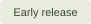

<div align="center">


### Move your computer life over. Tidy, checked, nothing lost.

An AI-guided kit for sorting out old drives, new laptops, and years of digital clutter.<br>
**You make the decisions. Your agent makes the plan. Your originals stay put.**

[](LICENSE)
[](#what-to-expect)
[](docs/USAGE.md#check-the-scripts)

[Get started](#quick-start) · [See a run](#what-a-run-looks-like) · [Safety](#the-safety-rules) · [FAQ](#faq) · [Contribute](CONTRIBUTING.md)

</div>

---

## What it does

New laptop? Old drives in a drawer? Files spread across folders you no longer recognize?

tidymove gives an AI agent a careful process to follow, with questions for you along the way. It includes instructions, reusable forms, and local copy-and-check scripts. It is **not a standalone app**: you use it with an AI tool that can work with local files.

- **Find what you have.** List files, folders, apps, and gaps without changing the originals.
- **Ask before guessing.** Answer short questions about unfamiliar folders and which version to keep.
- **Choose a useful layout.** Plan a home for your photos, documents, projects, and tools that can grow with you.
- **Copy, then check.** Preview the work first. Compare copied files with their originals before using them.
- **Leave a clear record.** Keep your decisions, results, recovery instructions, and anything still waiting.

Developers can also use the deeper guides for code history, virtual machines, app data, and agent setup. You do not need those to organize ordinary files.

## Quick start

**Already using Claude Code?** These commands start setup in about a minute, depending on your connection. They do not start copying files. You need a working Claude Code installation and account; the AI service may charge for usage.

Paste these into the **Claude Code conversation**, one line at a time:

```text
/plugin marketplace add https://github.com/Habeeb-MD-Faiz/tidymove
/plugin install tidymove@tidymove
```

Review the plugin details and confirm installation when prompted. Restart Claude Code, then enter:

```text
/tidymove:tidymove
```

Tell it:

> Help me organize my files with tidymove. Start by asking what I have and what I want to keep. Explain unfamiliar terms. Make a plan before changing anything.

The first step is a conversation. Your agent should ask about your devices, priorities, and a **private folder for the migration record**. Keep that folder outside the installed plugin and outside any public repository.

<details>
<summary><strong>Using Codex, Gemini, or another local-file agent?</strong></summary>

1. On [this repository](https://github.com/Habeeb-MD-Faiz/tidymove), choose **Code → Download ZIP**, then extract it into a new folder.
2. Open the extracted folder in your agent. Ask: **“Read AGENTS.md and skills/tidymove/SKILL.md. Help me start with the intake questions. Do not copy anything yet.”**
3. If you want just the plain skill, keep the entire `skills/tidymove/` folder together, including its `references/`, `templates/`, and `scripts/` folders. Point the agent directly to `SKILL.md`.

This is an instruction-based route; automatic skill discovery and permission controls differ by tool. A chat assistant without local file access cannot run the scripts for you.

</details>

<details>
<summary><strong>Trying the kit from a local checkout?</strong></summary>

In Claude Code, use `/plugin marketplace add <ABSOLUTE-PATH-TO-TIDYMOVE>`, then `/plugin install tidymove@tidymove`. Replace the placeholder with the full path to this folder. Restart and invoke `/tidymove:tidymove`.

</details>

For copy commands, requirements, and troubleshooting, see the [practical guide](docs/USAGE.md). You do not need to type those commands to start planning.

Plugin setup follows the [official Claude Code instructions](https://code.claude.com/docs/en/discover-plugins).

## What a run looks like

*Illustrative conversation; no real files or personal details.*

> **You:** I have an old drive and a new laptop. I don't know which folders matter.
>
> **Agent:** Let's list what's there first. I'll keep a record of anything I can't inspect.
>
> **Agent:** “Holiday photos” has no other confirmed copy. Should we copy it to your new Photos folder, keep it only on the old drive, or decide later? I recommend copying it.
>
> **You:** Copy it, but keep the old drive.
>
> **Agent:** Here's the proposed layout and the exact copy list. Review it before we begin.
>
> **Agent:** The selected files match after checking. Please open a few photos yourself before we switch to the new folder.

The full process has ten steps:

| Step | What happens |
|---|---|
| 0 · Understand | Agree on what matters, what is off limits, and what success means. |
| 1 · Protect and list | Confirm the old drive is protected against writes; list what is there. |
| 2 · Ask | Resolve unclear folders with short question batches. |
| 3 · Compare | Check old, current, and cloud copies before choosing what to use. |
| 4 · Design | Agree on folders, tools, access, and backups. |
| 5 · Review | Check the plan, space needed, recovery route, and preview results. |
| 6 · Copy | Copy approved items into folders that are not in use. |
| 7 · Verify | Check file contents and open representative files yourself. |
| 8 · Set up agents | If needed, rebuild approved agent settings and test their limits. |
| 9 · Finish | Record the result, keep the originals, and list unfinished work. |

A pause or new work can mean comparing copies again. That is part of the process.

## The safety rules

These are rules for the agent and safeguards in the scripts, **not a guarantee against mistakes or hardware failure**.

| Promise in the workflow | What it means |
|---|---|
| **Keep the originals** | No moving, deleting, renaming, repairing, or changing permissions on original files. |
| **Preview before copying** | Copy scripts default to a dry run: a preview with no destination data writes. They still write private logs and a lock file. |
| **Keep both when unsure** | Different existing files stop the copy. Partial copies and extra destination files stay in place. |
| **Check the contents** | By default, compare every selected file with SHA-256, a fingerprint calculated from its bytes. A sample check is clearly labeled as a sample. |
| **You control the risky steps** | Uploads, purchases, sign-ins, elevated changes, and switching to the new copies need your approval. |
| **Keep secrets with you** | Agents must not read or copy passwords, keys, or login data. Suspicious names stop ordinary copying; you handle those items separately. |
| **Say what is unknown** | Unreadable files, skipped items, failed checks, and incomplete backups stay in the record. |

Filename checks cannot detect every secret. Review what the agent may access, including ordinary-looking documents. Your AI provider may receive prompts, tool results, and filenames; local scripts do **not** make a cloud AI session private. Keep migration records private and follow your provider's data settings.

A second folder or partition on the same physical drive is not an independent backup. Keep another recoverable copy on a separate device or approved service.

## What to expect

- **Early release.** The process grew from an author-reported nine-day migration. That is background, not a certification or a promised completion time. Read the [generalized case study](skills/tidymove/references/case-study.md).
- **Windows first.** The synthetic smoke suite targets Windows PowerShell 5.1. Copying uses Windows' built-in robocopy.
- **macOS and Linux are experimental.** The shell recipes have not been tested on those platforms. They require Bash, Python 3.9+, and rsync 3.x. Validate them with made-up files before considering real data.
- **Ordinary files only in the generic copier.** Cloud-only files, shortcuts that point elsewhere, secrets, active databases, and special filesystem features need separate plans.
- **Planning can begin on a live laptop.** Production copying requires a source the scripts can prove read-only. Active system data needs a reviewed, consistent export first.

## FAQ

**Do I need to be a programmer?**

No. Start by describing your situation. Ask the agent to explain each step. Some device-protection and app-recovery steps need technical help; stop if you cannot confirm what a proposed command will affect.

**Will it delete duplicates?**

No. It helps compare copies and decide where each belongs. Originals and conflicting copies are retained.

**Can I leave it overnight?**

Only after approving a bounded copy plan, with logs, stop conditions, and no other program writing to the targets. Your agent must stop when it reaches a decision you have not approved.

**Does it upload my files?**

The bundled scripts do not upload them. Any cloud transfer is a separate approved operation. The AI tool itself may send conversation and tool context to its provider.

**Is it free?**

The kit is MIT licensed. Your AI tool, extra storage, and cloud services may cost money.

**How long does it take?**

Starting the conversation is quick. A migration can take hours or days depending on data size, drive health, questions, and verification. Measure a small transfer before estimating.

**Can I install it with pip or npm?**

No package is published by this project on either registry. Use the repository instructions above; similarly named packages may be unrelated.

**What if a check fails?**

Stop that batch. Keep the original, partial copy, and logs. Ask the agent to explain the failure and prepare a fresh reviewed plan. Do not disable a guard to make the result turn green.

## Contributing

Clearer instructions and reports from **synthetic test data** are welcome. Read [CONTRIBUTING.md](CONTRIBUTING.md) and our [code of conduct](CODE_OF_CONDUCT.md). Report vulnerabilities privately through the route in [SECURITY.md](SECURITY.md).

## License

[MIT](LICENSE) · Copyright the tidymove authors.
