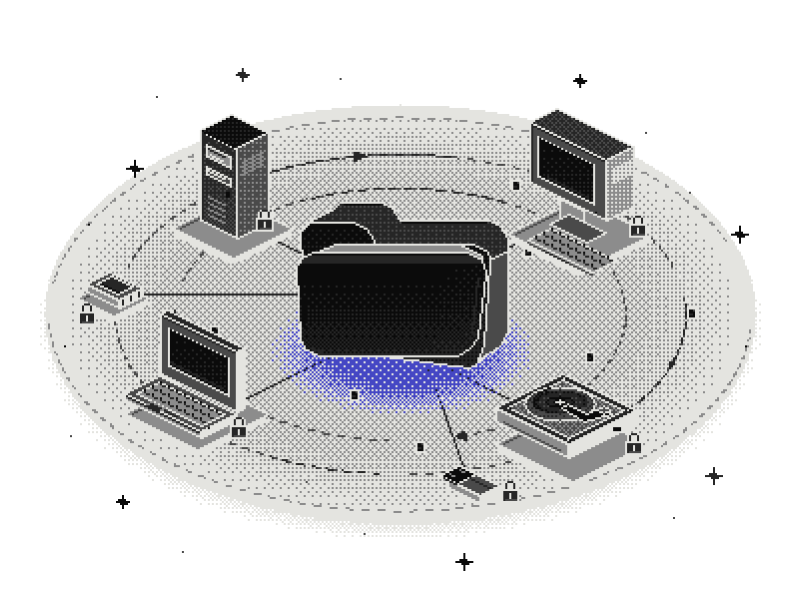

<p align="center">
  <picture>
    <source media="(prefers-color-scheme: dark)" srcset="assets/hero-dark.png">
    <source media="(prefers-color-scheme: light)" srcset="assets/hero-light.png">
    
  </picture>
</p>

<p align="center"><strong>tidymove</strong></p>

<p align="center">
  <a href="LICENSE"></a>
  <a href="#before-you-start"></a>
  <a href="docs/USAGE.md"></a>
  <a href="#install"></a>
</p>

# Every old drive. One tidy new home.

Your AI agent gathers the files you choose from old computers and drives, sorts them, and checks each copy.

[Website](https://tidymove.vercel.app) · [Install](#install) · [How it works](#how-a-move-works) · [Safety](#safety) · [FAQ](#faq) · [Contribute](CONTRIBUTING.md)
<!-- Update the website link when the custom domain is set. -->

## Install

Works with the agent you already use. You need it installed with local file access. Installing tidymove does not start copying files.

### Claude Code

Paste each line into the Claude Code conversation:

```text
/plugin marketplace add Habeeb-MD-Faiz/tidymove
/plugin install tidymove@tidymove
```

Review the installation prompt, then restart Claude Code or reload its plugins. Ask it to help you plan a move with tidymove.

### Codex

Paste this into the Codex conversation, not a terminal, then restart Codex:

```text
$skill-installer install https://github.com/Habeeb-MD-Faiz/tidymove/tree/main/skills/tidymove
```

### Cursor

Clone the repo in a terminal, then open the cloned folder in Cursor:

```shell
git clone https://github.com/Habeeb-MD-Faiz/tidymove
```

Ask in the Cursor conversation:

```text
Read AGENTS.md and help me plan a move.
```

### Gemini CLI

Install the skill from your terminal and review the confirmation prompt:

```shell
gemini skills install https://github.com/Habeeb-MD-Faiz/tidymove.git --path skills/tidymove
```

### Any other agent

Clone the repo in a terminal, then open your agent in the cloned folder:

```shell
git clone https://github.com/Habeeb-MD-Faiz/tidymove
```

Ask in the agent conversation:

```text
Read AGENTS.md and help me plan a move.
```

The agent must be able to read local files and follow the linked skill. Automatic discovery and permissions vary by tool.

For requirements, copy commands and install sources, see the [practical guide](docs/USAGE.md). Keep your move’s record in a private folder outside the installed kit and any public repository.

## How a move works

1. **Take stock.** Your agent lists the drives, folders and kinds of file in scope, flags likely secrets, and records anything it cannot read. The originals stay unchanged.
2. **Ask.** Anything unclear becomes a quick multiple-choice card with a recommended answer. You decide, and “Other” is always there.
3. **Plan.** It drafts a clean folder layout for the new home and shows you where everything will land before anything is copied. Files with the same name can receive different names in the new home.
4. **Copy.** Files are copied, never moved. The old drives are only read, and stay exactly as they were.
5. **Verify.** By default, selected files are counted and checked by checksum on both sides. Failed checks and skipped items stay in the record.
6. **Set up.** Your agents get a safe setup on the new machine: where things live, what they may touch, and what stays off-limits.
7. **Hand over.** You get a written record of what was copied where, what was checked, and what is left for later.

## Safety

Your originals stay put.

- **Copy, never move.** The old drives are only read, never written to.
- **Proof, not trust.** By default, every selected file is counted and checksummed on both sides.
- **You decide.** Nothing unclear is guessed. It becomes a question for you.
- **Secrets stay with you.** Your agent is told to leave passwords, keys and tokens alone, and to keep them out of its notes.

These are workflow rules and script safeguards, not a guarantee against mistakes or hardware failure. You approve source protection; tidymove does not make drives read-only automatically. Filename checks cannot detect every secret. Keep an independent backup on a separate device or approved service.

The scripts inspect parent folder metadata to reject unsafe paths, including during synthetic tests. They cannot work within a strict subtree boundary. See the [script boundary and test results](docs/USAGE.md#check-the-scripts) before running a sandbox test.

## Before you start

| | |
|---|---|
| **Status** | Early release. |
| **Systems** | Windows first, using Windows PowerShell 5.1 and robocopy. macOS and Linux are not tested yet. |
| **Licence** | MIT, free and open source. |
| **You need** | An AI coding agent you already use, with local file access. The old drives connected, and room on the new one. |
| **Accounts** | No tidymove account, sign-up or tracking. Your AI tool has its own account and usage terms. |

This is a kit of instructions, templates and scripts, not a standalone app. The generic copier handles ordinary local files. Cloud-only files, links, secrets and active databases need [separate plans](docs/USAGE.md#what-needs-a-separate-plan).

## FAQ

<details>
<summary>Does it move or delete my files?</summary>

No. It copies. The originals are only read and stay exactly as they were. Clearing an old drive later is your call, after the checks pass.

</details>

<details>
<summary>Does my data leave my computer?</summary>

tidymove has no server and no tracking. Files are copied drive to drive on your machine. Your AI provider may receive filenames, tool results and any file contents your agent reads.

</details>

<details>
<summary>Which agents does it work with?</summary>

Claude Code as a plugin. Codex, Cursor, Gemini CLI and others through the skill and the AGENTS.md file in the repo.

</details>

<details>
<summary>What if a copy fails partway?</summary>

Copies are checked, not assumed. If a check fails, the batch stops. The original, partial copy and logs are kept while your agent prepares a fresh plan for review.

</details>

<details>
<summary>Is it free?</summary>

Yes. MIT licensed and open source. Your AI tool, extra storage and cloud services may cost money.

</details>

[Contributing](CONTRIBUTING.md) · [Code of conduct](CODE_OF_CONDUCT.md) · [Security](SECURITY.md) · [MIT licence](LICENSE)
